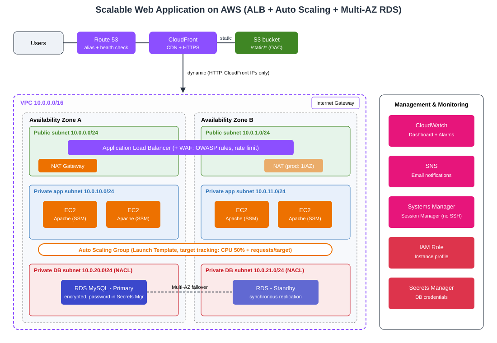

<h1 align="center">Scalable Web Application on AWS</h1>
<p align="center"><b>ALB + Auto Scaling + CloudFront + Multi-AZ RDS</b><br>
AWS Solutions Architect – Associate | Graduation Project 1<br>
<b>Author:</b> Mohamed Gahlan Mohamed Abdeltawab 

## Table of Contents

- [Solution Overview](#solution-overview)
- [Architecture Diagram](#architecture-diagram)
- [AWS Services Used](#aws-services-used)
- [Repository Structure](#repository-structure)
- [Prerequisites](#prerequisites)
- [Deployment](#deployment)
- [Testing and Validation](#testing-and-validation)
- [Well-Architected Mapping](#well-architected-mapping)
- [Cost Estimation](#cost-estimation)
- [Challenges and Lessons Learned](#challenges-and-lessons-learned)
- [Future Improvements](#future-improvements)
- [Clean Up](#clean-up)
- [License](#license)

# Solution Overview

A production-style, highly available web application deployed with **Terraform**. Traffic enters through **CloudFront** and an **Application Load Balancer** and is served by **EC2 instances in an Auto Scaling Group** running in private subnets across **two Availability Zones**. A **Multi-AZ RDS MySQL** database stores data in an isolated database tier. The environment is monitored with CloudWatch and alerts are sent through SNS.

# Architecture Diagram



**Request flow**
1. The user resolves the domain through **Route 53** (optional) and reaches **CloudFront**.
2. `/static/*` is served from a private **S3** bucket (Origin Access Control) and cached at the edge.
3. All other requests go to the **ALB**, protected by **WAF**. Its security group only accepts CloudFront IPs.
4. The ALB distributes traffic to healthy **EC2** instances in the private app subnets.
5. Instances talk to **RDS** in the private DB subnets. Only the app security group can reach port 3306.
6. Instances reach the internet (patches, SSM) through the **NAT Gateway**. Admins connect with **Session Manager** (no SSH, no bastion).

# AWS Services Used

| Service | Purpose | Design decision |
|---|---|---|
| VPC | 3-tier network, 2 AZs | Public / private-app / private-DB subnets; DB route table has no internet route |
| NAT Gateway | Outbound internet for private subnets | 1 NAT for cost in demo (`single_nat_gateway=false` gives 1 per AZ for production) |
| Security Groups | Stateful firewall | ALB → App → DB chain using SG references, no SSH rule |
| NACL | Stateless extra layer on DB subnets | Allows only MySQL from the app subnets |
| EC2 + Launch Template | Web servers | AL2023, IMDSv2 required, encrypted gp3 EBS |
| Auto Scaling Group | Elasticity + self-healing | Target tracking on **CPU 50%** and **100 requests/target**; ELB health checks |
| ALB | Layer 7 load balancing | Health check on `/health` |
| WAF | App protection | AWS managed Common (OWASP), SQLi, Known Bad Inputs, IP Reputation + rate limit |
| CloudFront | CDN | Static → S3 (cached), dynamic → ALB (not cached) |
| S3 | Static assets | Private bucket, access only through CloudFront OAC |
| RDS MySQL Multi-AZ | Database | Automatic failover, encrypted, 7-day backups, password in Secrets Manager |
| Route 53 | DNS (optional) | Alias to CloudFront + health check |
| Systems Manager | Secure access | Session Manager through IAM role |
| CloudWatch + SNS | Observability | Dashboard + 4 alarms (5XX, unhealthy hosts, ASG CPU, RDS CPU) with email alerts |

# Repository Structure

```
.
├── README.md
├── LICENSE
├── .gitignore
├── architecture.svg
└── terraform/
    ├── main.tf        # provider, AMI, AZs
    ├── variables.tf
    ├── network.tf     # VPC, subnets, IGW, NAT, route tables, NACL
    ├── security.tf    # security groups
    ├── compute.tf     # IAM, launch template, ASG, scaling policies
    ├── alb_waf.tf     # ALB, target group, WAF
    ├── database.tf    # RDS Multi-AZ
    ├── edge.tf        # S3, CloudFront, Route 53 (optional)
    ├── monitoring.tf  # SNS, alarms, dashboard
    ├── outputs.tf
    └── user_data.sh   # bootstraps Apache
```

# Prerequisites

- An AWS account with permissions to create VPC, EC2, RDS, CloudFront, WAF, IAM and S3 resources
- [AWS CLI](https://aws.amazon.com/cli/) configured (`aws configure`)
- [Terraform](https://developer.hashicorp.com/terraform/install) >= 1.5
- Git

# Deployment

### 1. Clone the repository
```bash
git clone https://github.com/<your-username>/aws-scalable-web-app.git
cd aws-scalable-web-app/terraform
```

### 2. Configure variables
```bash
cp terraform.tfvars.example terraform.tfvars
# edit terraform.tfvars and set alert_email
```

### 3. Validate, plan and deploy
```bash
terraform init
terraform validate
terraform plan
terraform apply
```
Deployment takes about 15–20 minutes (RDS Multi-AZ and CloudFront are the slowest). Confirm the SNS subscription email, then open the `cloudfront_url` output in your browser.

# Testing and Validation

| Test | How | Expected result |
|---|---|---|
| Load balancing | Refresh the CloudFront URL repeatedly | Instance ID / AZ changes |
| Static via CDN | Open `/static/logo.svg` and check the `X-Cache` header | `Hit from cloudfront` on repeat requests |
| Self-healing | Terminate one EC2 instance in the console | ASG launches a replacement; ALB keeps serving |
| Auto scaling | Run a load test (below) | Instance count grows up to `asg_max`, then scales in |
| RDS failover | RDS → Actions → *Reboot with failover* | DB comes back in the other AZ |
| WAF | `curl "https://<url>/?id=1' OR '1'='1"` | HTTP 403 |
| Secure access | EC2 → Connect → Session Manager | Shell opens with no port 22 |
| Alerts | Stop all instances or trigger load | SNS email received |

Load test example:
```bash
# using Apache Bench
ab -n 200000 -c 200 https://<cloudfront_url>/
```
Note: the CloudFront default behavior does not cache dynamic content, so requests reach the ALB and trigger scaling.

# Well-Architected Mapping

- **Reliability:** Multi-AZ everywhere, ASG self-healing, ELB health checks, RDS automated failover and backups.
- **Security:** private subnets, least-privilege SG chain, WAF, IMDSv2, encryption at rest (EBS, RDS), no SSH, Secrets Manager.
- **Performance:** CloudFront caching, auto scaling on two metrics.
- **Cost optimization:** t3.micro, single NAT in demo, scale-in when idle, `terraform destroy`.
- **Operational excellence:** Infrastructure as Code, dashboard, alarms, rolling instance refresh.

# Cost Estimation

| Item | ~USD/month |
|---|---|
| 2× t3.micro EC2 | 15 |
| NAT Gateway (1) | 33+ |
| ALB | 18+ |
| RDS db.t3.micro Multi-AZ | 25 |
| CloudFront, S3, WAF, CloudWatch | 10–15 |
| **Total** | **~100** |

Check current prices in the AWS Pricing Calculator. For a demo, deploy, take screenshots or a video, then destroy (cost for a few hours is only a few dollars).

# Challenges and Lessons Learned

_Write your own here, for example:_
- Why the ALB security group references the CloudFront managed prefix list.
- Why private instances need a NAT Gateway for SSM.
- Difference between target tracking and step scaling.
- Why static and dynamic content need different CloudFront cache policies.

# Future Improvements

HTTPS between CloudFront and ALB with ACM, one NAT per AZ, RDS read replicas, Secrets Manager rotation, CI/CD for the Terraform code.

# Clean Up

To avoid charges, destroy everything after taking your screenshots or recording the demo:
```bash
cd terraform
terraform destroy
```

# License

This project is licensed under the MIT License. See the [LICENSE](LICENSE) file.
